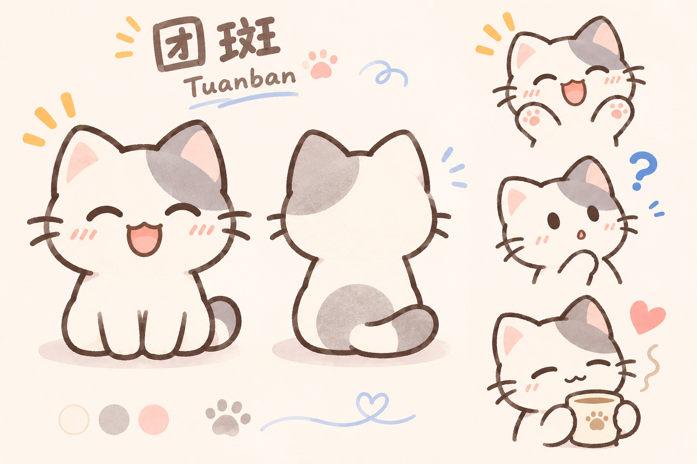

# Tuanban · 团斑 🐾

> A little cat holding everyday feelings in its paws

**Tuanban** is a round, warm-hearted white cat with a gray patch over the viewer-right side of its head, pink inner ears, brown hand-drawn outlines and rosy cheeks.

This is an **independent open character-art and sticker repository**, not a Hermes plugin. It can provide assets to Hermes Lively or any other compatible application.

## Starter stickers

| Greeting | Happy | Confused | Comfort / rest |
|:--:|:--:|:--:|:--:|
|  |  |  |  |

Four opaque RGB PNG files, **192 × 192 px** and under **40 KiB** each. Browse the descriptions in `stickers/manifest.json`. The full-size `art/character-sheet.png` is a style reference, not a production sticker.

Read the [character guide](docs/CHARACTER.md), [style guide](docs/STYLE-GUIDE.md), and [contribution rules](CONTRIBUTING.md).

Validate the assets with `python3 scripts/validate.py` (standard library only).

## License and origins

The repository is published under **[MPL-2.0](LICENSE)** insofar as contributors have rights they can license. The illustrations are AI-assisted, selected and prepared for this collection. Publication does not promise exclusivity, copyright eligibility, or trademark clearance. The name Tuanban / 团斑 has not been formally cleared or registered as a trademark. MPL-2.0 does not grant trademark rights. See [ASSET-NOTICE.md](ASSET-NOTICE.md).

No third-party copyrighted meme or franchise art is included.
