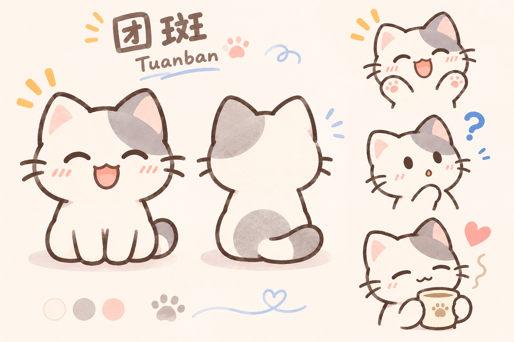

# 团斑 · Tuanban 🐾

> 一只把小情绪捧在爪心里的猫  
> A little cat holding everyday feelings in its paws



**团斑（Tuanban）** 是一只圆乎乎的灰白小猫：额头右侧的灰色斑块、粉色耳朵、暖棕色手绘线条和红扑扑的脸颊，是它的标志

这个仓库独立收录团斑的角色设定和可复用表情包素材。它**不是 Hermes 插件**；[Hermes Lively](https://github.com/Xarth-Mai/hermes-plugin-lively) 等项目可以将它作为独立素材来源，用户也可以在自己的应用或聊天工具里使用

## 第一弹 · 四张表情

| 打招呼 | 开心 | 疑惑 | 安心休息 |
|:--:|:--:|:--:|:--:|
|  |  |  |  |
| `greeting.png` | `happy.png` | `confused.png` | `comfort.png` |

- 每张 **192 × 192 px、RGB PNG、无透明通道、≤ 40 KiB**
- `stickers/manifest.json` 包含语义、描述和尺寸约束，可供 Agent 或应用检索
- `art/character-sheet.png` 是高清角色设定参考，不属于 192 px 表情包
- 没有下载脚本、外部模型或运行时依赖

## 角色设计

- [角色设定与性格](docs/CHARACTER.md)
- [画风、配色和表情包规范](docs/STYLE-GUIDE.md)
- [新增素材与贡献](CONTRIBUTING.md)

核心要点是温暖、好奇、稍微天然呆；表情可以很丰富，但角色外观要保持可辨认。后续可以扩充动作、日常场景和更多语言版本

## 验证素材

```bash
python3 scripts/validate.py
```

仅使用 Python 标准库，CI 会自动检查四张示例图片的格式、尺寸、透明通道和大小

## 许可与创作说明

仓库内的原创角色设定、PNG 图片、描述和检验脚本按 **[Mozilla Public License 2.0](LICENSE)（MPL-2.0）** 发布，限于贡献者依法有权许可的部分。图片采用 AI 辅助生成，并经挑选与整理；开源发布不等于对作品的可版权性、独创性或商标可注册性作出保证。名称“团斑 / Tuanban”尚未完成正式商标检索或注册

MPL-2.0 允许使用、修改及再分发，但应遵循通知和源文件等条件；它不自动授予商标权。具体说明见 [ASSET-NOTICE.md](ASSET-NOTICE.md) 和 [Mozilla MPL FAQ](https://www.mozilla.org/en-US/MPL/2.0/FAQ/)

本仓库独立于 NianYu 和 Hermes Lively，**不包含**任何来自第三方动漫、网络表情包或未经明确授权的图片素材
