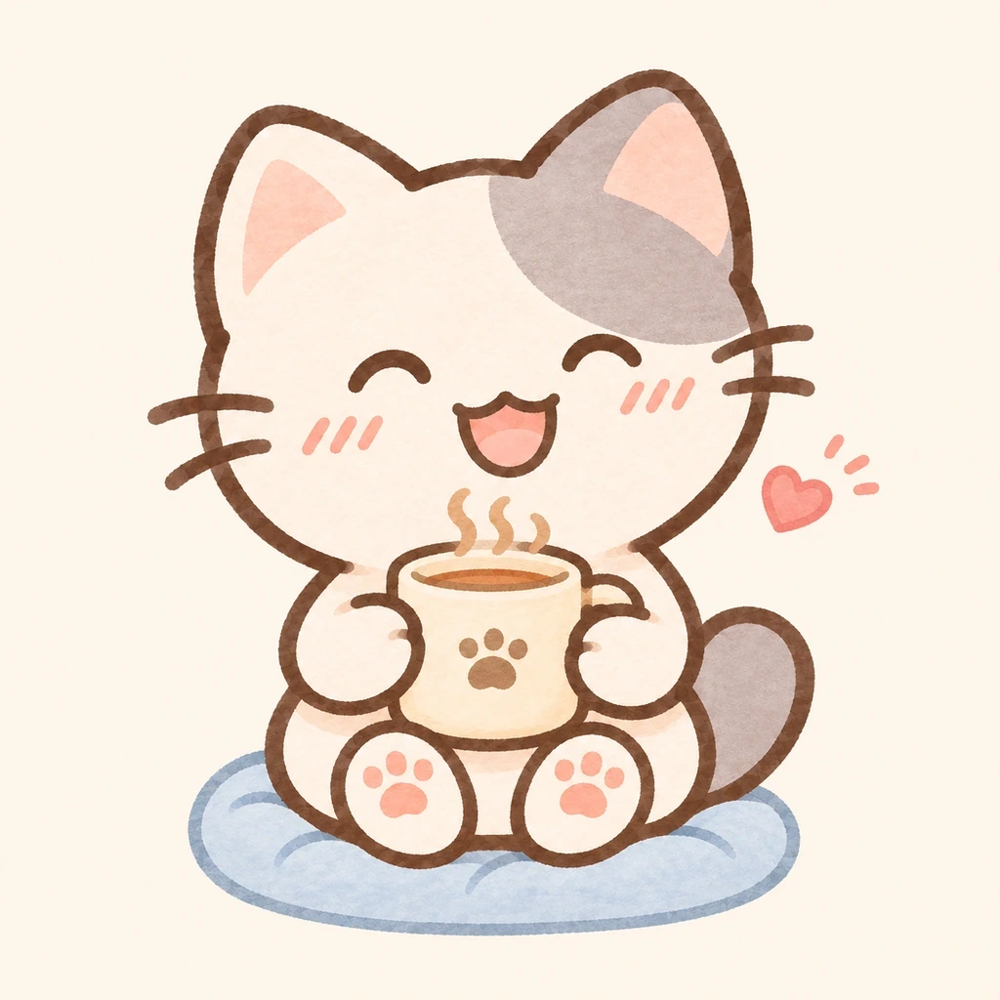
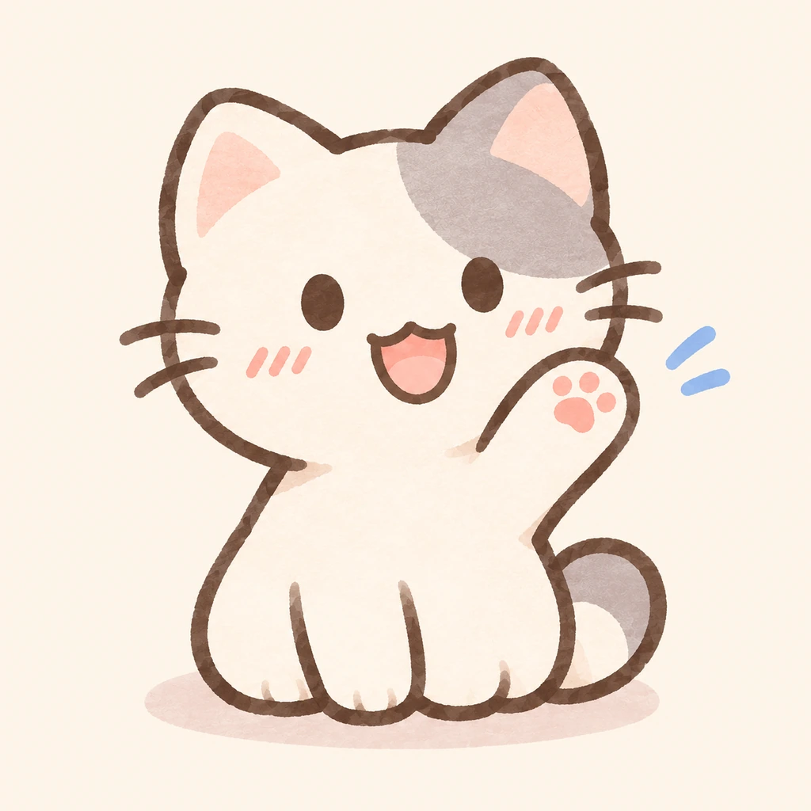
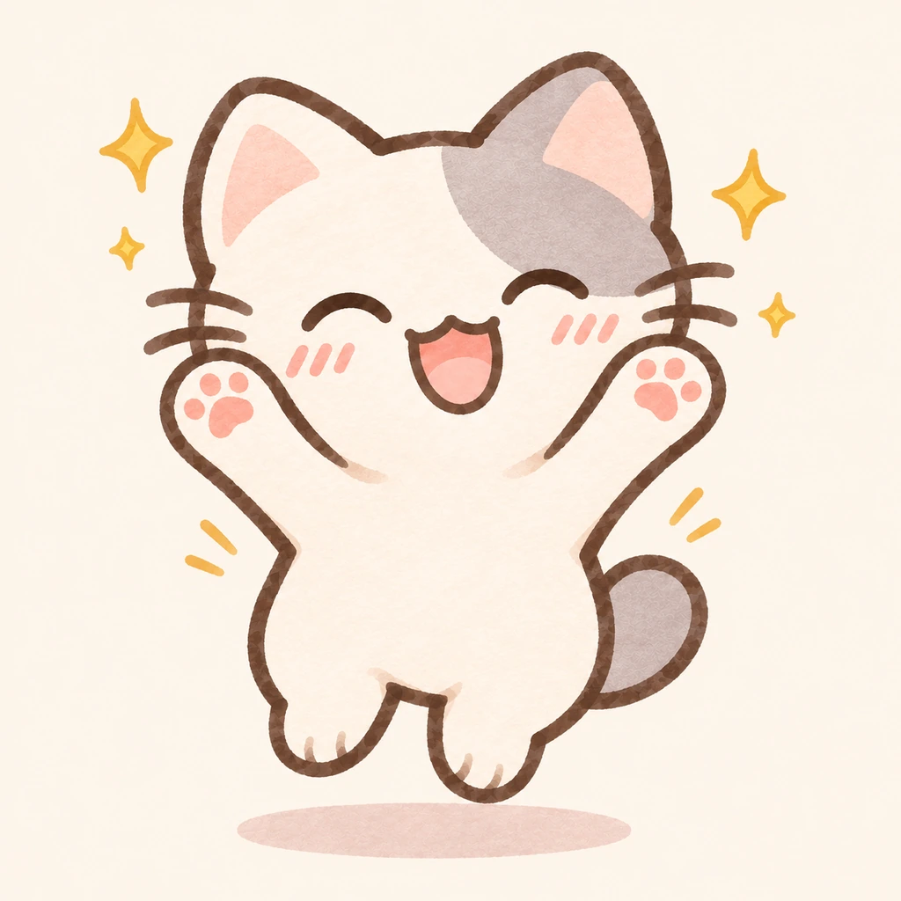
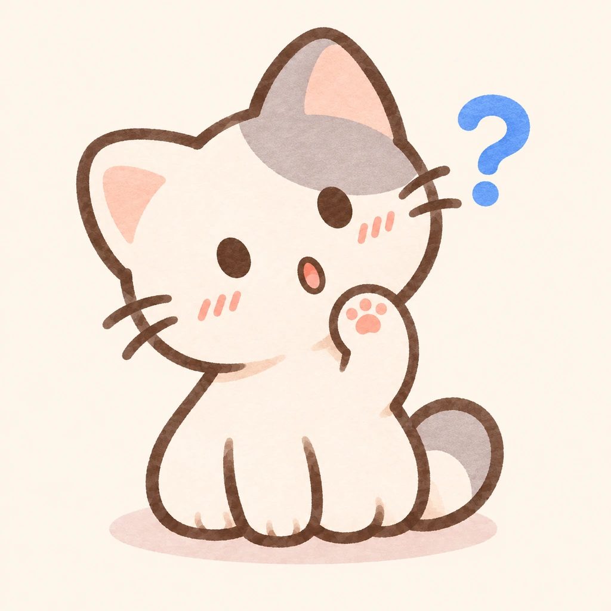
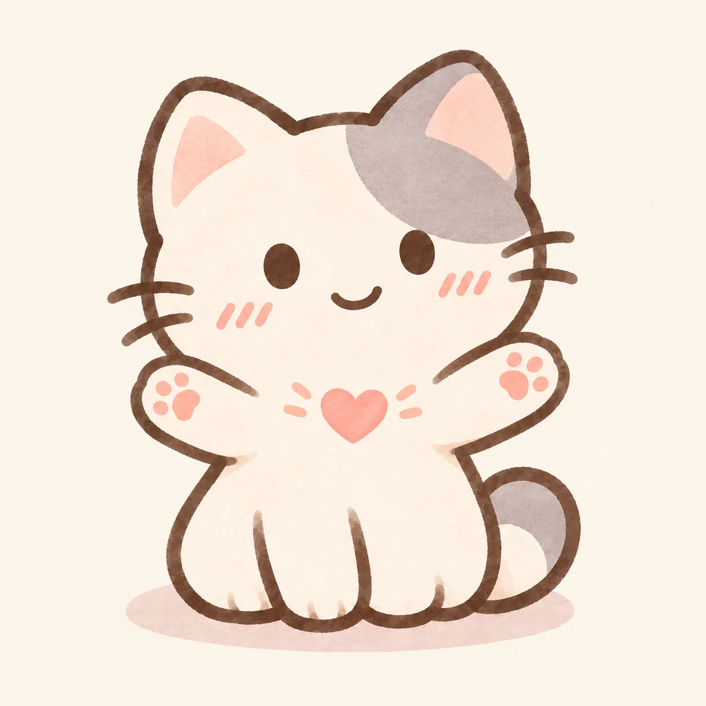

# 团斑 · Tuanban

> 一只把小情绪捧在爪心里的猫

团斑是一只温柔、慢热、有一点害羞的灰白花小猫。她喜欢热饮、软垫和安静的陪伴，也喜欢用小动作表达那些说不出口的心情。

这里收集着她的故事、视觉设定与表情贴图。欢迎认识她，也欢迎把这份小小的温柔带进自己的日常与创作。

## 今天是什么小情绪？

  
  
  
  

目前收录 **12 张正式贴图**，涵盖问候、开心、疑惑和安慰。每张都有独立的 WebP 图片、情绪关键词和适合使用的场景。

**[浏览角色主页](index.html)** · **[查看贴图库](assets/stickers/)**

## 认识团斑

圆圆的脸、粉色耳朵、软软的肉垫，还有正面画面右侧那块醒目的灰斑，都是她的标志。

她不急着替谁决定心情。开心时陪你举爪，疑惑时歪头一起想，累的时候就抱着热饮安静坐一会儿。

[角色小传](docs/character-profile.md) · [视觉规范](docs/visual-guidelines.md) · [贴图创作规范](docs/sticker-guidelines.md)

## 浏览与使用

这是一个不需要构建或后端的静态角色网站。下载仓库后，**直接打开 `index.html`** 就可以浏览、搜索和保存贴图；也可以通过静态 HTTP 服务器访问。

要在自己的项目中引用素材，请使用 **[manifest.json](data/manifest.json)**。它提供素材路径、分类、关键词、尺寸和校验信息；图片存放在 [assets/stickers](assets/stickers/) 中。

想为团斑添一个新表情？请看 [贡献指南](CONTRIBUTING.md)。

## 许可与素材

本仓库的代码、角色资料与图像按照 [MPL-2.0](LICENSE) 在依法可许可的权利范围内开放使用。插画包含 AI 辅助生成内容，使用或再分发前请阅读 [素材与授权说明](ASSET-NOTICE.md)。

---

*小小的心情，也值得被轻轻接住。*
